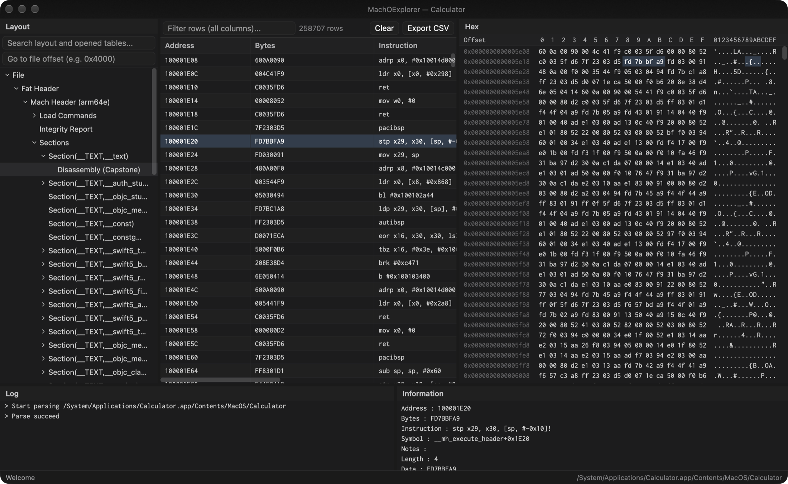
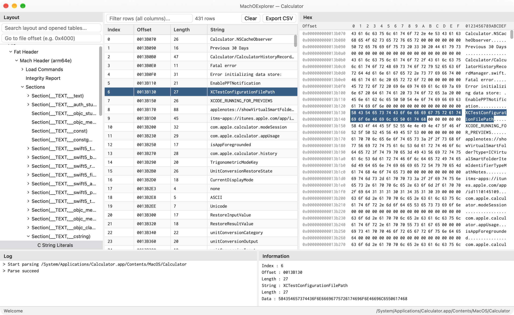

# MachOExplorer

[Discord](https://discord.gg/eGzEaP6TzR)

Repository: <https://github.com/everettjf/machoexplorer>

> A focused desktop explorer for Mach-O binaries, Fat/Universal binaries, `.a` archives, and the dyld shared cache — built for people who reverse engineer and inspect Apple binaries.

Language: **English** | [简体中文](README.zh-CN.md)

| Dark theme | Light theme |
| --- | --- |
|  |  |

[](LICENSE)
[](https://github.com/everettjf/MachOExplorer/actions/workflows/rust.yml)
[](https://github.com/everettjf/MachOExplorer/releases/latest)
[](#install)

MachOExplorer turns an opaque Mach-O file into a navigable tree. Open a binary and drill from the
file structure all the way down to load commands, sections, symbols, disassembly, and Apple-specific
metadata (Objective-C, Swift, code signing) — in one window, or fully scripted from the command line.

Current major release: `v3.0.1` ([release page](https://github.com/everettjf/MachOExplorer/releases/tag/v3.0.1)).
Version 3 is a rewrite in Rust with a [GPUI](https://www.gpui.rs/) interface; it replaces the
C++/Qt implementation of the 2.x releases. If you used the 2.x command-line tools, see
[Migrating from 2.x](#migrating-from-2x).

> **Looking for the old C++/Qt version?** Versions up to `v2.0.17` were written in C++ with Qt;
> from version 3 on, MachOExplorer is written in Rust. The last C++/Qt source is kept at the
> [`qt-final`](https://github.com/everettjf/MachOExplorer/tree/qt-final) tag and on the
> [`legacy-qt`](https://github.com/everettjf/MachOExplorer/tree/legacy-qt) branch, and the old builds
> are still on the [releases page](https://github.com/everettjf/MachOExplorer/releases).

## Contents
- [Features](#features)
- [Supported formats](#supported-formats)
- [Install](#install)
- [Quick start](#quick-start)
- [Command line](#command-line)
- [Migrating from 2.x](#migrating-from-2x)
- [Build from source](#build-from-source)
- [Docs](#docs)
- [Contributing](#contributing)
- [License](#license)

## Features

### Structure & navigation
- Layout tree: file → header → load commands → sections / symbols / link-edit data.
- Search box that filters the layout tree by node name **and** matches the contents of tables you have already opened.
- Go-to-offset box: type a file offset to jump to the node that contains it.
- Hex view stays in sync with the selected node — jump from any table row to the exact bytes.

### Apple binary internals
- Load commands, sections, symbol & string tables, relocations, indirect symbols, function starts, data-in-code.
- **Code signing**: parses the embedded-signature SuperBlob (Code Directory, Requirements, CMS) and decodes the **entitlements** plist.
- **Objective-C** metadata: classes, methods, ivars, properties, and protocols.
- **Swift** semantic graph over the `__swift5_*` sections.
- **dyld info**: rebase / bind / lazy-bind / exports trie and chained-fixups structures.

### Code & cross-references
- [Capstone](https://www.capstone-engine.org/) disassembly of every code section (arm64, x86_64, arm, i386). Capstone is built in; nothing extra to install.
- Xref report: call / jump targets, computed addresses and memory references found in the code, plus stored pointers, tied back to symbols.

### dyld shared cache
- List images, extract a single image or all of them, and drill straight into an extracted image.

### Productivity & UX
- Parsing runs **off the UI thread**, so opening a large binary or a multi-gigabyte shared cache keeps the window responsive.
- Tables: row filter across all columns, copy cell / row / all visible rows, CSV export, keyboard navigation.
- Open a running process by PID: by its executable path (macOS, Linux) or from a memory snapshot of its main image (macOS only).
- Light and dark themes, or follow the system setting.
- Built-in update check reads stable GitHub Releases over HTTPS. Successful results are cached for one hour; downloads open the matching release in your browser.

### Automation
- The `moex` command-line tool prints the full analysis as text or **stable JSON** — ideal for scripting, diffing, and CI.

### Built for suspicious files
The parser is bounds- and alignment-checked throughout — LEB128 streams, load-command walking,
string tables, and code-signature blobs — and is covered by malformed-input tests that run it
against truncated and mutated binaries, plus a fuzz target. Opening a hostile or corrupted file
is meant to degrade gracefully instead of crashing.

## Supported formats
| Format | Notes |
| --- | --- |
| Mach-O | 32-bit and 64-bit |
| Fat / Universal | Multiple architecture slices |
| Static archive | `.a` with Mach-O members |
| dyld shared cache | List, extract, and inspect images |

## Install

| Platform | Status |
| --- | --- |
| macOS 13 or later (Apple silicon and Intel) | Supported. Signed and notarized releases. |
| Linux (x86_64, glibc 2.35 or later) | Preview. A tarball is built and its command-line tool is tested in CI; the desktop app has not been tried on a real desktop yet. |
| Windows 10 or later (x64) | Preview. An installer and a portable zip are built and the command-line tool is tested in CI; the desktop app has not been tried on a real desktop yet. The binaries are not code-signed, so SmartScreen may warn. |

### macOS
- Download the latest release: <https://github.com/everettjf/MachOExplorer/releases/latest>
- Or install via Homebrew:

```bash
brew update && brew tap everettjf/homebrew-tap && brew install --cask machoexplorer
```

The app bundle also contains the command-line tool, at
`MachOExplorer.app/Contents/MacOS/moex`.

### Linux
Download `MachOExplorer-<version>-linux-x86_64.tar.gz` from the
[latest release](https://github.com/everettjf/MachOExplorer/releases/latest) and unpack it. The
binaries are `bin/MachOExplorer` and `bin/moex`; a `.desktop` file and an icon are under `share/`.
The desktop app needs a Vulkan-capable GPU driver.

### Windows
Download `MachOExplorer-Setup-<version>.exe` (installer) or
`MachOExplorer-<version>-windows-x64-portable.zip` from the
[latest release](https://github.com/everettjf/MachOExplorer/releases/latest). Both contain
`MachOExplorer.exe` and `moex.exe`, and need no extra runtime.

Linux and Windows are previews: please [report](https://github.com/everettjf/MachOExplorer/issues)
what you find.

Attaching to a process by memory snapshot is macOS only. Swift symbols are demangled by
Swift's own demangler, built into the tool, on every platform. C++ symbols are demangled by
the C++ runtime on macOS and Linux and by the `cpp_demangle` crate on Windows, where the text
can differ.

## Quick start
1. Launch MachOExplorer, or open a file directly: `MachOExplorer <path>`. You can also drop a
   file onto the window.
2. Open a bundled sample (`sample/simple`, `sample/complex`) or your own binary.
3. Walk the **Layout** tree; type in the search box to jump to a section, symbol, or value; select a
   node to see its table and the matching bytes in the hex view.

Keyboard shortcuts (Cmd on macOS, Ctrl elsewhere): `N` new window, `W` close window, `O` open
file, `F` focus the table filter, `Q` quit.

## Command line
The `moex` tool runs the same analysis without the GUI:

```bash
moex dump sample/simple
moex dump --format json --output simple-analysis.json sample/simple
```

| Subcommand | Purpose |
| --- | --- |
| `moex dump [options] <file>` | Export the full analysis tree as text or JSON |
| `moex parse <file>...` | Check that files parse |
| `moex diff <fileA> <fileB>` | Compare header, sections and symbols of two files |
| `moex cache-list ...` | List the images of a dyld shared cache |
| `moex cache-extract ...` | Extract images from a dyld shared cache |

Common `moex dump` options:

| Option | Description |
| --- | --- |
| `--format text\|json` | Output format (default `text`) |
| `--output <path>` | Write analysis output to a file |
| `--max-rows <N>` | Limit rows per table (`0` = unlimited) |
| `--max-depth <N>` | Limit tree depth (`0` = unlimited) |
| `--root-path <path>` | Export only one matching analysis subtree |
| `--name-filter <text>` | Keep nodes whose display names match the text |
| `--table-mode <full\|headers\|summary>` | Control table payload size |
| `--include-empty` | Include empty nodes |

The JSON output is automation-friendly and stable: it includes `schemaVersion`, a `summary`, node
`path` / `kind` / `childIndex`, and row `cells` / `rowIndex`. String values are sanitized to valid
UTF-8 so output stays well-formed even on malformed input. See [CLI.md](CLI.md) for the full guide.

## Migrating from 2.x
The 2.x releases shipped a Qt application with a `--cli` mode and separate `moex-*` tools. They
are now subcommands of one binary:

| 2.x | 3.x |
| --- | --- |
| `MachOExplorer --cli [options] <file>` | `moex dump [options] <file>` |
| `moex-parse <file>...` | `moex parse <file>...` |
| `moex-diff <fileA> <fileB>` | `moex diff <fileA> <fileB>` |
| `moex-cache-list ...` | `moex cache-list ...` |
| `moex-cache-extract ...` | `moex cache-extract ...` |

Options and exit codes are the same. The analysis itself now follows the Mach-O format where
the 2.x releases did not; what changed is listed in
[docs/analysis-notes.md](docs/analysis-notes.md). `MachOExplorer --cli` itself no longer
exists: the `MachOExplorer` binary is the GUI only. Details are in
[CLI.md](CLI.md#migrating-from-2x).

## Build from source
Requirements: a stable [Rust](https://www.rust-lang.org/tools/install) toolchain and a C compiler.
Qt, CMake and a system Capstone are no longer needed.

```bash
cargo build --release -p moex-cli      # command-line tool: target/release/moex
cargo build --release -p moex-app      # desktop app:       target/release/MachOExplorer
./target/release/MachOExplorer sample/simple
```

On macOS, `scripts/bundle_macos.sh` assembles `dist/macos/MachOExplorer.app`.

On Debian/Ubuntu the desktop app needs these packages first:

```bash
sudo apt-get install -y build-essential pkg-config clang \
  libxkbcommon-dev libxkbcommon-x11-dev libwayland-dev libx11-xcb-dev \
  libxcb1-dev libfontconfig-dev libfreetype-dev libvulkan-dev \
  libasound2-dev libssl-dev
```

On Windows use the MSVC toolchain; the binaries are `target\release\MachOExplorer.exe` and
`target\release\moex.exe`.

See [DEVELOP.md](DEVELOP.md) for the full developer, testing, and release workflow.

## Docs
- Developer guide (build / test / release): [DEVELOP.md](DEVELOP.md)
- CLI guide: [CLI.md](CLI.md)
- Packaging notes: [docs/release_packaging.md](docs/release_packaging.md)
- Changes from the 2.x analysis and known limits: [docs/analysis-notes.md](docs/analysis-notes.md)

## Contributing
Issues and pull requests are welcome:
- Project: <https://github.com/everettjf/MachOExplorer>
- Issues: <https://github.com/everettjf/MachOExplorer/issues>

Before opening a PR, please run `cargo test --workspace` and `tests/regression/run_all.sh`.

## License
MIT. See [LICENSE](LICENSE).

## Star History
[](https://star-history.com/#everettjf/MachOExplorer)
