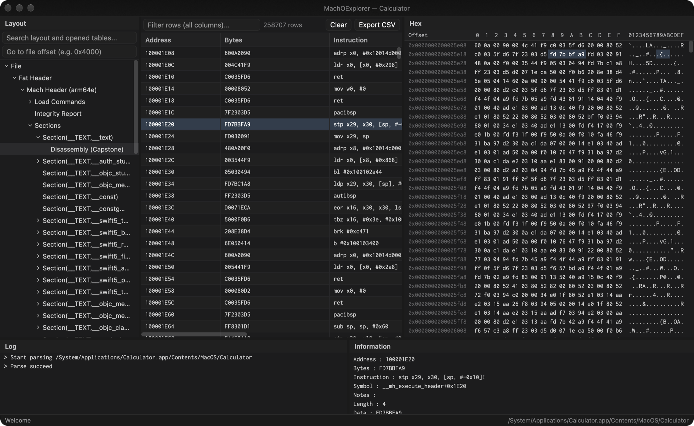

# MachOExplorer

[Discord](https://discord.gg/eGzEaP6TzR)

> 一个聚焦 Apple 二进制的桌面分析工具——支持 Mach-O、Fat/Universal、`.a` Archive 与 dyld shared cache，为逆向与二进制审查而生。

语言：简体中文 | [English](README.md)



[](LICENSE)
[](https://github.com/everettjf/MachOExplorer/actions/workflows/rust.yml)
[](https://github.com/everettjf/MachOExplorer/releases/latest)
[-lightgrey)](#安装)

MachOExplorer 把一个晦涩的 Mach-O 文件变成可导航的树。打开一个二进制，从文件结构一路钻取到
load command、section、符号、反汇编，以及 Apple 特有的元数据（Objective-C、Swift、代码签名）——
在一个窗口里完成，也可以完全用命令行脚本化。

当前发布版本：`v3.0.0`（[发布页](https://github.com/everettjf/MachOExplorer/releases/tag/v3.0.0)）。
3.x 版本使用 Rust 重写，界面基于 [GPUI](https://www.gpui.rs/)，取代了 2.x 的 C++/Qt 实现。
如果你用过 2.x 的命令行工具，请看[从 2.x 迁移](#从-2x-迁移)。

## 目录
- [功能](#功能)
- [支持的格式](#支持的格式)
- [安装](#安装)
- [快速开始](#快速开始)
- [命令行](#命令行)
- [从 2.x 迁移](#从-2x-迁移)
- [从源码构建](#从源码构建)
- [文档](#文档)
- [贡献](#贡献)
- [许可证](#许可证)

## 功能

### 结构与导航
- Layout 树：文件 → header → load commands → section / 符号 / link-edit 数据。
- 搜索框：按节点名过滤布局树，**并且**能匹配你已打开过的表格里的内容。
- 偏移跳转框：输入文件偏移，直接跳到包含该偏移的节点。
- Hex 视图与所选节点联动——从任意表格行跳到对应字节。

### Apple 二进制内部结构
- Load commands、section、符号表与字符串表、重定位、间接符号、function starts、data-in-code。
- **代码签名**：解析 embedded-signature SuperBlob（Code Directory、Requirements、CMS），并解码 **entitlements** plist。
- **Objective-C** 元数据：类、方法、ivar、属性、协议。
- **Swift** 语义图（基于 `__swift5_*` 段）。
- **dyld 信息**：rebase / bind / lazy-bind / exports trie 与 chained-fixups 结构。

### 代码与交叉引用
- [Capstone](https://www.capstone-engine.org/) 反汇编 `__TEXT,__text`（arm64、x86_64、arm、i386）。Capstone 已内置，无需另外安装。
- Xref 报告：解析 call / jump 目标并关联回符号。

### dyld shared cache
- 列出镜像、提取单个或全部镜像，并直接钻入已提取的镜像分析。

### 体验与效率
- 解析在 **UI 线程之外**进行，打开大型二进制或数 GB 的 shared cache 也不卡界面。
- 表格：跨所有列的行筛选、复制单元格 / 行 / 全部可见行、CSV 导出、键盘导航。
- 按 PID 打开正在运行的进程：通过可执行文件路径（macOS、Linux），或通过主镜像的内存快照（仅 macOS）。
- 浅色、深色主题，或跟随系统。
- 内置更新检查：通过 HTTPS 读取 GitHub Releases 的稳定版本，成功结果缓存一小时；下载时在浏览器中打开对应的发布页。

### 自动化
- 命令行工具 `moex` 以文本或**稳定 JSON** 输出完整分析——适合脚本、diff 与 CI。

### 为可疑文件而设计
解析器全程做了边界与对齐校验——LEB128 流、load command 遍历、字符串表、代码签名 blob——
并有针对畸形输入的测试（对截断和变异后的二进制运行）以及一个 fuzz 目标。打开恶意或损坏文件时，
程序应当优雅地降级而不是崩溃。

## 支持的格式
| 格式 | 说明 |
| --- | --- |
| Mach-O | 32 位与 64 位 |
| Fat / Universal | 多架构 slice |
| 静态库 | 含 Mach-O 成员的 `.a` |
| dyld shared cache | 列出、提取并检视镜像 |

## 安装

| 平台 | 状态 |
| --- | --- |
| macOS 13 及以上（Apple silicon 与 Intel） | 支持。发布包已签名并公证。 |
| Linux | 尚未验证。构建已接入 CI 和 `scripts/package_linux.sh`，但还没有人实际构建或运行过。 |
| Windows | 尚未验证。构建已接入 CI 和 `scripts/build_windows_installer.ps1`，但还没有人实际构建或运行过。 |

### macOS
- 下载最新版本：<https://github.com/everettjf/MachOExplorer/releases/latest>
- 或通过 Homebrew 安装：

```bash
brew update && brew tap everettjf/homebrew-tap && brew install --cask machoexplorer
```

应用包内同时带有命令行工具，位于 `MachOExplorer.app/Contents/MacOS/moex`。

### Linux / Windows
请从源码构建（见[从源码构建](#从源码构建)），并欢迎反馈实际情况。

通过内存快照附加进程仅限 macOS。Swift 符号由内置的 Swift 官方 demangler 还原，所有平台均可用。
C++ 符号在 macOS 上由系统 `libc++abi` 还原，在其他平台由 `cpp_demangle` crate 还原，
因此不同平台上还原出的文本可能略有差异。

## 快速开始
1. 启动 MachOExplorer，或直接打开文件：`MachOExplorer <路径>`。也可以把文件拖到窗口上。
2. 打开内置示例（`sample/simple`、`sample/complex`）或你自己的二进制。
3. 浏览 **Layout** 树；在搜索框输入即可跳到某个 section、符号或数值；选中节点即可在 Hex 视图看到对应字节。

快捷键（macOS 用 Cmd，其他平台用 Ctrl）：`N` 新建窗口，`W` 关闭窗口，`O` 打开文件，
`F` 聚焦表格筛选框，`Q` 退出。

## 命令行
`moex` 工具无需界面即可执行同样的分析：

```bash
moex dump sample/simple
moex dump --format json --output simple-analysis.json sample/simple
```

| 子命令 | 用途 |
| --- | --- |
| `moex dump [options] <file>` | 以文本或 JSON 导出完整分析树 |
| `moex parse <file>...` | 检查文件能否解析 |
| `moex diff <fileA> <fileB>` | 对比两个文件的 header、section 与符号 |
| `moex cache-list ...` | 列出 dyld shared cache 中的镜像 |
| `moex cache-extract ...` | 从 dyld shared cache 提取镜像 |

`moex dump` 常用参数：

| 参数 | 说明 |
| --- | --- |
| `--format text\|json` | 输出格式（默认 `text`） |
| `--output <path>` | 输出到文件 |
| `--max-rows <N>` | 每个表最多输出 N 行（`0` 表示不限制） |
| `--max-depth <N>` | 限制分析树深度（`0` 表示不限制） |
| `--root-path <path>` | 仅导出某个分析子树 |
| `--name-filter <text>` | 仅保留名称匹配的节点 |
| `--table-mode <full\|headers\|summary>` | 控制表格载荷大小 |
| `--include-empty` | 包含空节点 |

JSON 输出便于自动化且稳定：包含 `schemaVersion`、`summary`、节点级 `path` / `kind` / `childIndex`，
以及行级 `cells` / `rowIndex`；所有字符串都会被净化为合法 UTF-8，即使输入畸形也能保证输出良构。
完整说明见 [CLI.zh-CN.md](CLI.zh-CN.md)。

## 从 2.x 迁移
2.x 版本提供带 `--cli` 模式的 Qt 应用和若干独立的 `moex-*` 工具。现在它们都是同一个二进制的子命令：

| 2.x | 3.x |
| --- | --- |
| `MachOExplorer --cli [options] <file>` | `moex dump [options] <file>` |
| `moex-parse <file>...` | `moex parse <file>...` |
| `moex-diff <fileA> <fileB>` | `moex diff <fileA> <fileB>` |
| `moex-cache-list ...` | `moex cache-list ...` |
| `moex-cache-extract ...` | `moex cache-extract ...` |

参数与退出码保持不变，并且在测试语料上，JSON 输出会与最后一个 C++ 版本的输出逐项比对。
少数有意为之的差异列在 [docs/rust-port-quirks.md](docs/rust-port-quirks.md)。
`MachOExplorer --cli` 本身已不存在：`MachOExplorer` 二进制只是图形界面。
详见 [CLI.zh-CN.md](CLI.zh-CN.md#从-2x-迁移)。

## 从源码构建
依赖：稳定版 [Rust](https://www.rust-lang.org/tools/install) 工具链和 C 编译器。
不再需要 Qt、CMake 或系统安装的 Capstone。

```bash
cargo build --release -p moex-cli      # 命令行工具：target/release/moex
cargo build --release -p moex-app      # 桌面应用：  target/release/MachOExplorer
./target/release/MachOExplorer sample/simple
```

在 macOS 上，`scripts/bundle_macos.sh` 会组装出 `dist/macos/MachOExplorer.app`。

在 Debian/Ubuntu 上，桌面应用需要先安装以下依赖（尚未验证）：

```bash
sudo apt-get install -y build-essential pkg-config clang \
  libxkbcommon-dev libxkbcommon-x11-dev libwayland-dev libx11-xcb-dev \
  libxcb1-dev libfontconfig-dev libfreetype-dev libvulkan-dev \
  libasound2-dev libssl-dev
```

在 Windows 上请使用 MSVC 工具链；产物为 `target\release\MachOExplorer.exe` 和
`target\release\moex.exe`（尚未验证）。

完整的开发、测试与发布流程见 [DEVELOP.md](DEVELOP.md)。

## 文档
- 开发文档（构建 / 测试 / 发布）：[DEVELOP.md](DEVELOP.md)
- CLI 文档：[CLI.zh-CN.md](CLI.zh-CN.md)
- 打包说明：[docs/release_packaging.md](docs/release_packaging.md)
- 与 C++ 实现的差异：[docs/rust-port-quirks.md](docs/rust-port-quirks.md)

## 贡献
欢迎提交 Issue 和 PR：
- 项目地址：<https://github.com/everettjf/MachOExplorer>
- 问题反馈：<https://github.com/everettjf/MachOExplorer/issues>

提交 PR 前，请先运行 `cargo test --workspace` 和 `tests/regression/run_all.sh`。

## 许可证
MIT，详见 [LICENSE](LICENSE)。

## Star History
[](https://star-history.com/#everettjf/MachOExplorer)
